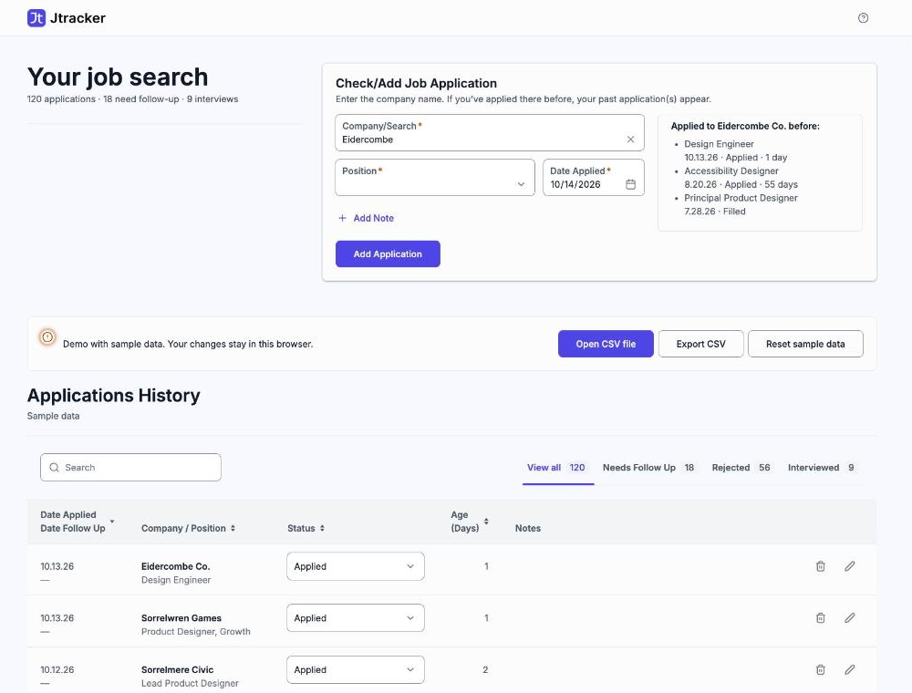

# Jtracker

A job-application tracker for people who apply a lot. Type a company, see
whether you've applied there before, add the new one, and know which
applications are due for a follow-up.

**Live demo:** <https://jtracker.fredtranfield.com> (sample data; your
changes stay in your browser)

<!-- TODO: add docs/screenshot.png (sample data only) -->
<!--  -->

## Why I built it

My job search outgrew a spreadsheet. Nearly 300 applications in, two
questions kept costing me time: *Have I already applied here?* and *Who
should I follow up with today?* A spreadsheet can answer both, slowly.
Jtracker answers them as you type.

It's also a design-engineering exercise: designed in Figma and **in code**, built in React
and TypeScript, and styled with [octet-scss](https://github.com/ptoly/octet-scss),
my own 8-point grid SCSS framework.

## What it does

- **Check and add in one step.** Start typing a company name. If you've
  applied there before, your past applications appear under the field.
  Matching is forgiving: case, punctuation and suffixes like Inc or LLC
  don't matter.
- **Follow-up reminders.** An application is due for a follow-up when it's
  still *Applied*, has no follow-up date, and is 10 or more days old. Due
  rows are flagged and collected in their own tab.
- **A summary that answers "how am I doing?"** The page title shows totals:
  applications, follow-ups due and interviews.
- **Fast updates.** Change a status right in the table; choosing *Followed
  Up* fills in today's date. Everything else is one Edit away.
- **Your own position list.** Pick positions from the ones you've used,
  add new ones, rename or hide them.

## Your data stays yours

There's no Jtracker server. Data goes from your browser to a place you
control:

| Storage | Where your data lives | Browsers |
| --- | --- | --- |
| **Demo** | This browser only, seeded with fictional sample data. Reset any time. | All |
| **CSV file** | A `.csv` file on your computer that you open once. Jtracker reads and saves it directly. | Chrome, Edge, Opera (desktop) |
| **Google Sheets** | A Google Sheet you choose. Jtracker asks for access to that one file only (`drive.file`). | All |

<!-- TODO: Import / Export CSV for Safari and Firefox -->

Age and follow-up status are calculated each time the app loads, never
stored, so they're always current.

## Design decisions

- **16px minimum text.** Including table cells and form fields.
- **3:1 control borders.** Inputs and selects use a border that meets WCAG
  1.4.11 against the page (`#8b929f`, 3.05:1). Many popular UI kits ship
  field borders around 1.5:1.
- **44px touch targets** for icon buttons, following Apple's guideline.
- **Explicit over minimal.** Required fields keep their asterisks, optional
  ones say so, and helper text spells out defaults. A form you use dozens of
  times a day shouldn't make you guess.
- **Delete sits before Edit.** Stray clicks land on the last icon in a row,
  so the destructive action isn't there. Delete also asks to confirm.
- **No pure white or black.** Surfaces use a near-white (`#fcfcfd`) and
  text a near-black, which is easier on the eyes over long sessions.
- **One source of truth for style.** Colors are tokens shared with the
  Figma file as variables. Spacing lives in one file and steps on an 8pt
  grid, following [octet's conventions](https://github.com/ptoly/octet-scss/blob/main/CONVENTIONS.md).
- **Native first.** Real `<table>`, `<select>` and `<button>` elements,
  with ARIA only where HTML runs out. Changes are announced to screen
  readers through polite live regions.

## Built with

React 19 · TypeScript (strict) · Vite · Sass with
[octet-scss](https://www.npmjs.com/package/octet-scss) · Downshift
(position combobox) · Storybook with the a11y addon · Vitest

## Run it locally

Requires Node 20.19 or later (built on Node 24).

```bash
npm install
npm run dev          # http://localhost:5173
npm run storybook    # component library at http://localhost:6006
npm test             # unit tests
```

Without any setup, the app runs in demo mode. Opening a CSV file needs no
setup either.

### Optional: Google Sheets

1. In [Google Cloud](https://console.cloud.google.com), create a project and
   enable the **Google Sheets API**, **Google Picker API** and **Google Drive
   API**.
2. Set up the OAuth consent screen (External, Testing) and add yourself as a
   test user. Add the scope `.../auth/drive.file` only.
3. Create an OAuth client (Web application) with your dev URL as an
   authorized JavaScript origin.
4. Create an API key restricted to the Picker API and your site.
5. Copy `.env.example` to `.env.local` and fill in the client ID, API key
   and project number.

The browser-only Google sign-in expires hourly, so on longer sessions you'll
be asked to reconnect. That's a limit of signing in without a server, and
the main reason the CSV option exists.

## Project structure

```
src/
  components/   UI components, one folder each, with Storybook stories
  lib/          Pure logic: dates, follow-up rules, company matching
  storage/      StorageAdapter plus demo, CSV and Google Sheets adapters
  styles/
    theme/      Tokens, typography, shared spacing and layout
    components/ One BEM partial per component
design/         Figma mockups the UI was built against
```

The UI only talks to storage through `StorageAdapter`, so a new backend
is one new file.

## License

MIT
